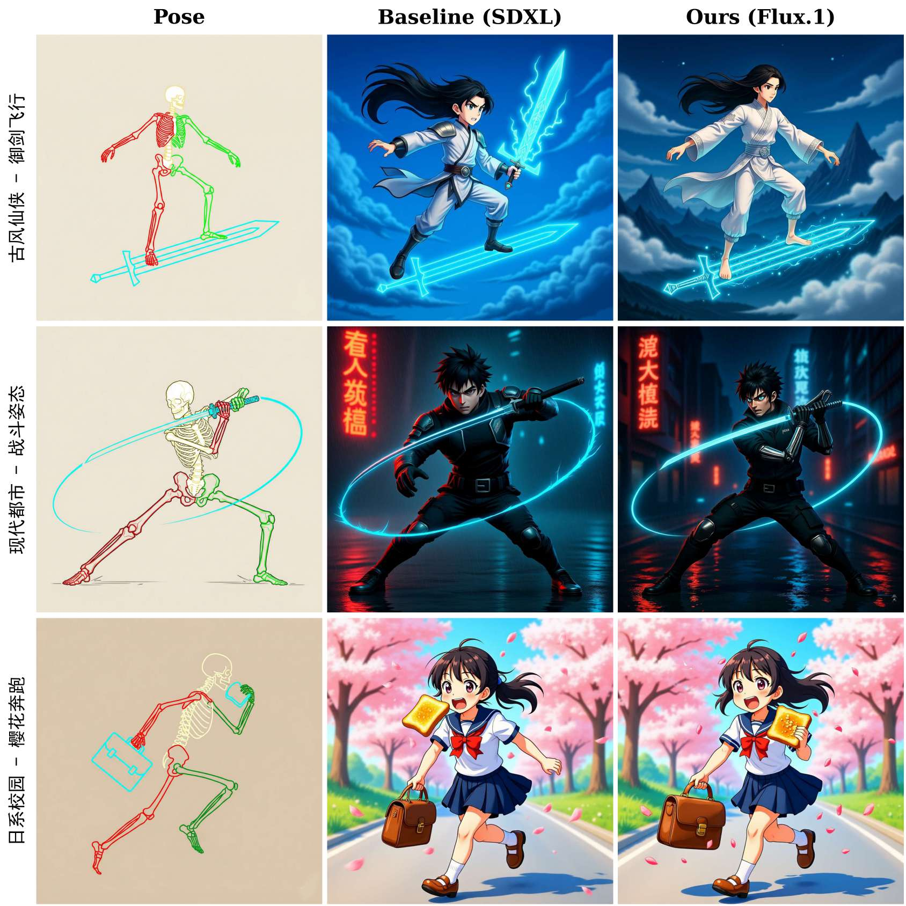
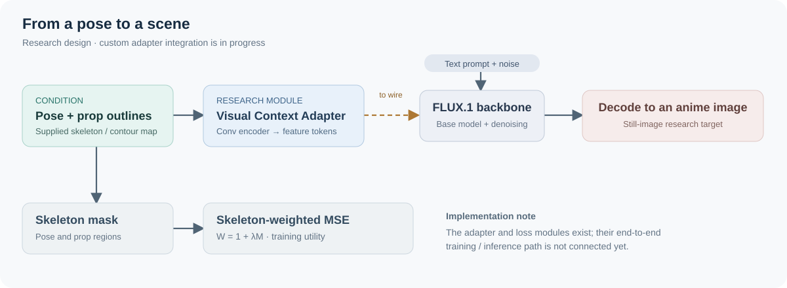
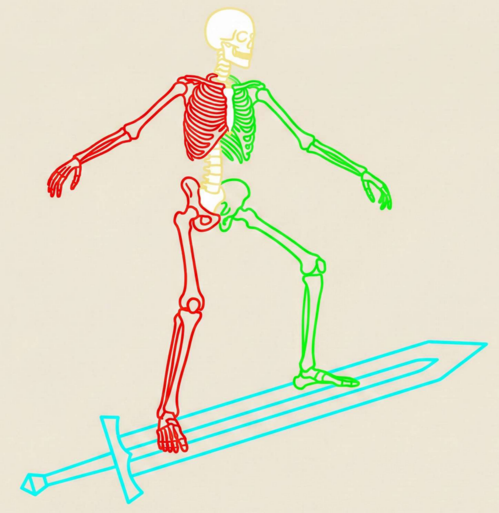

<div align="center">

# PoseCanvas
### 姿态驱动的动漫画布

从一个姿态、一件道具，到一幅有故事的画面。基于 FLUX.1 探索可控动漫图像生成。

[English](README.md) · **简体中文**

[效果展示](#效果展示) · [研究思路](#研究思路) · [运行基础演示](#运行基础-flux-演示) · [实现进度](docs/research-status.md)

</div>

<table>
<tr>
<td width="33%"></td>
<td width="33%"></td>
<td width="33%"></td>
</tr>
<tr><td align="center">御剑飞行</td><td align="center">霓虹街头</td><td align="center">春日奔跑</td></tr>
</table>

*以上为项目技术报告中的静态图像示例。[查看图片来源](assets/posecanvas/SOURCES.md)。*

PoseCanvas 是围绕**人物姿态、道具位置与动漫图像生成**开展的课程研究项目。仓库整理了报告可视化、骨架预处理工具、Visual Context Adapter 和骨架加权损失模块，同时保留 FLUX 原有的图像生成演示。

> **当前范围：**自定义姿态条件训练与推理脚本仍是待接通的研究原型。展示图来自技术报告，并非运行当前仓库后重新生成的结果。Gradio 与 Streamlit 演示使用基础 FLUX 流程。[查看具体实现情况 →](docs/research-status.md)

## 效果展示

报告选取了御剑飞行、都市战斗姿态、校园樱花奔跑三个场景。每一行依次展示姿态条件、报告中的 SDXL 基线图像与 FLUX.1 示例。



*保留报告原图及其列标题。这些图片用于展示选定案例，不代表对当前仓库重新开展的独立评测，也不据此给模型作普遍性能排名。*

## 研究思路

先用骨架和道具轮廓描述**人物如何站立、物体放在哪里**，再用文本描述场景。骨架编码器将条件图转换为视觉特征序列；空间加权损失则为骨架和道具区域分配更高的训练权重。



<table>
<tr>
<td width="28%"></td>
<td>
<strong>让道具也成为构图的一部分</strong><br><br>
报告将人体骨架与显式道具轮廓组合成条件图。这个例子里，青色线条标出了剑的几何轮廓。<br><br>
预处理模块可以绘制已提供的关键点与轮廓，Adapter 将图像编码为特征序列；特征与生成骨干之间的连接仍需补全。
</td>
</tr>
</table>

| 可以探索的内容 | 代码入口 |
| --- | --- |
| 姿态归一化、数据增强与道具轮廓绘制 | [`preprocess.py`](src/flux/data/preprocess.py) |
| 图像／骨架／文本描述的数据读取 | [`dataset.py`](src/flux/data/dataset.py) |
| 卷积式 Visual Context Adapter | [`adapter.py`](src/flux/modules/adapter.py) |
| 骨架掩码与加权损失 | [`loss.py`](src/flux/modules/loss.py) |
| 待完善的训练与推理脚本 | [`train.py`](src/flux/train.py)、[`inference.py`](src/flux/inference.py) |

项目目前研究静态图像，尚未实现视频生成或时序一致性。

## 运行基础 FLUX 演示

使用 **Python 3.10+** 与支持 CUDA 的 GPU。下面的命令启动仓库继承的基础 FLUX 演示，并不会运行尚未接通的自定义姿态条件流程。模型权重和文本编码器体积较大；`--offload` 可以减少 GPU 驻留，但仍需要较多系统内存，本文不承诺固定的最低显存配置。

### 安装

```bash
git clone https://github.com/masktrump19-sudo/posecanvas.git
cd posecanvas
python -m venv .venv
```

Linux/macOS 使用 `source .venv/bin/activate` 激活环境；Windows PowerShell 使用 `.venv\Scripts\Activate.ps1`。

根据机器环境，按 [PyTorch 官方说明](https://pytorch.org/get-started/previous-versions/) 安装兼容版本。仓库目标版本为 PyTorch 2.6.0；若环境支持 CUDA 12.4，可使用：

```bash
python -m pip install torch==2.6.0 torchvision==0.21.0 --index-url https://download.pytorch.org/whl/cu124
python -m pip install -e ".[gradio,streamlit]"
```

根目录的 `requirements.txt` 是包含特定 CUDA 与 ComfyUI 包的历史环境快照，不建议把它当作跨平台安装入口。

### 启动

```bash
# Gradio：基础文生图演示
python demo_gr.py --name flux-schnell --offload

# Streamlit：在界面中选择基础模型
streamlit run demo_st.py -- --offload=True
```

使用 FLUX.1-dev 时，先在 [官方模型页面](https://huggingface.co/black-forest-labs/FLUX.1-dev) 获取访问资格，再将 Gradio 命令中的模型改为 `--name flux-dev`。基础演示也为支持的模型提供图生图选项，这与骨架条件控制是两条不同的流程。

缺少的模型文件会从 Hugging Face 下载。已有本地权重时，可在启动前将 `FLUX_MODEL` 与 `FLUX_AE` 分别设置为对应文件路径；自动下载文件保存在 `checkpoints/<仓库名>/` 下。请按模型条款使用权重，访问受限模型时使用本人已授权的 Hugging Face 账号，勿将令牌写入代码或提交。

Gradio 默认本地运行，只有显式添加 `--share` 才创建公开分享链接。本次文档整理核对了代码入口与参数，未进行完整 GPU 推理测试。

## 数据与权重

- [项目数据集合集](https://huggingface.co/datasets/Huangyongqing/FLUX-SDXL-ALL-DATASET)
- [项目权重合集](https://huggingface.co/Huangyongqing/flux-inference-weights)
- [FLUX.1-dev 官方模型卡](https://huggingface.co/black-forest-labs/FLUX.1-dev)
- [FLUX.1-schnell 官方模型卡](https://huggingface.co/black-forest-labs/FLUX.1-schnell)

项目合集作为资料入口保留。基础 FLUX 权重不等同于已训练的 PoseCanvas Adapter 权重；当前仓库尚未说明一套可完整复现姿态条件流程的兼容 Adapter 发布包。

## 一起完善

欢迎围绕 Adapter 与骨干模型的连接、完整训练流程、检查点加载、可复现姿态生成案例展开合作。[实现说明](docs/research-status.md)列出了当前缺口，也欢迎在 [Issues](https://github.com/masktrump19-sudo/posecanvas/issues) 中交流具体的实验或改进思路。

如果这份代码或可视化研究对你有帮助，欢迎点一个 Star，让更多开发者看到它。

## 致谢与许可

基于 [Black Forest Labs 的 FLUX 实现](https://github.com/black-forest-labs/flux)，设计参考了 [ControlNet](https://github.com/lllyasviel/ControlNet) 与 [T2I-Adapter](https://github.com/TencentARC/T2I-Adapter)。保留上游代码、模型卡与许可声明。

仓库代码采用 [Apache 2.0](LICENSE)。模型权重遵循各自条款，见 [FLUX.1-dev 许可](model_licenses/LICENSE-FLUX1-dev) 与 [FLUX.1-schnell 许可](model_licenses/LICENSE-FLUX1-schnell)。代码许可不替代模型、数据集及第三方图像的使用条款；展示图片来源见[图片说明](assets/posecanvas/SOURCES.md)。
